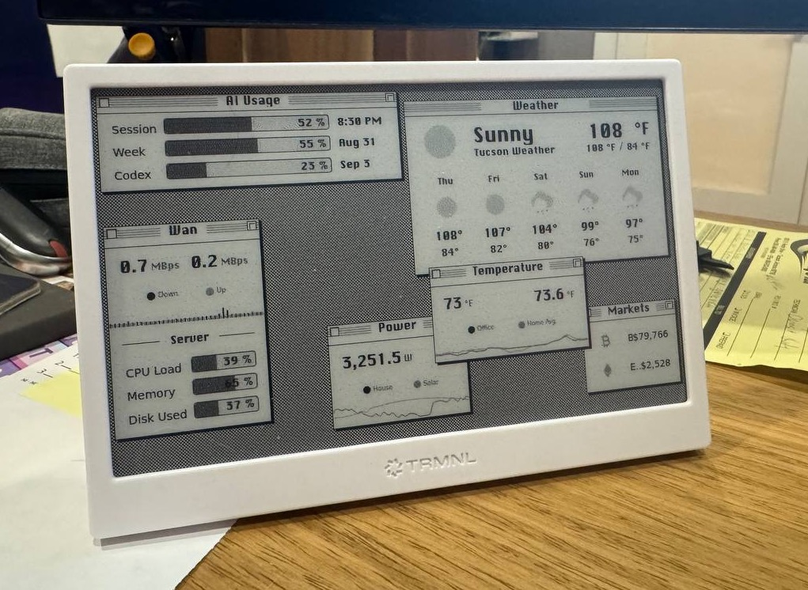
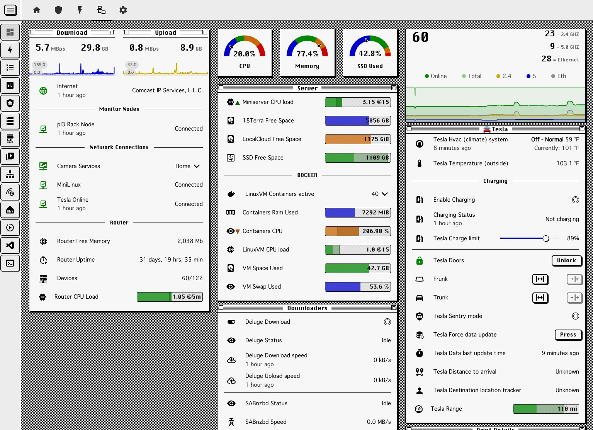
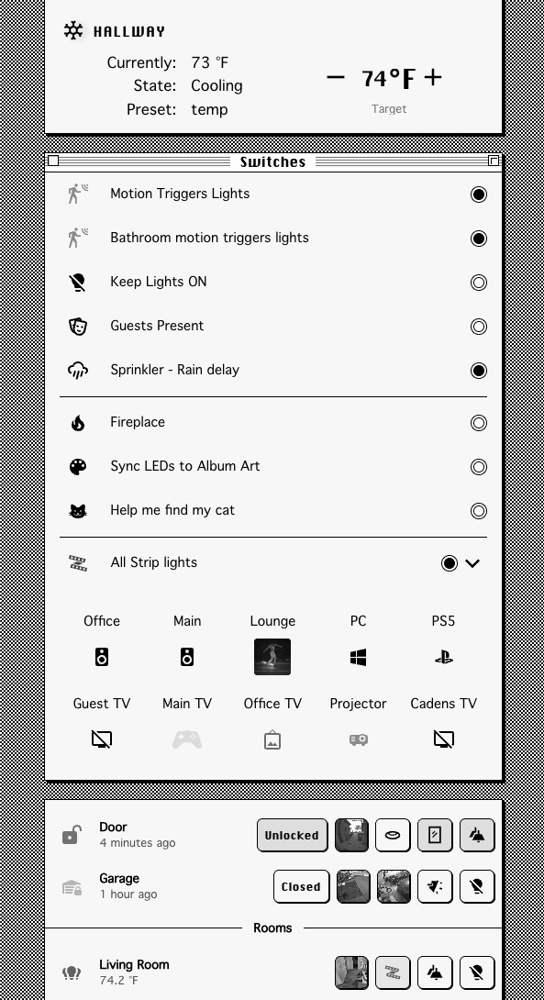
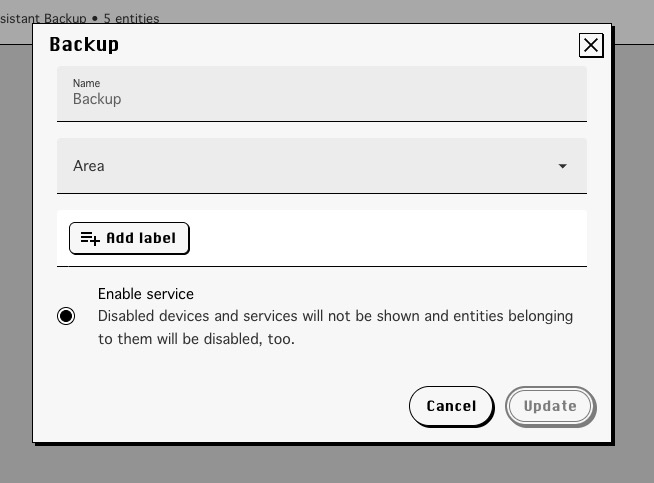

# MacOS System 7 Theme for Home Assistant

[](https://github.com/skynet01/homeassistant-macos-system7-theme/releases/latest)
[](https://github.com/hacs/integration)
[](LICENSE)
[](https://www.home-assistant.io/)

A pair of global light themes that make Home Assistant feel like a Macintosh running
System 7. The primary version is designed for black-and-white e-ink displays; a color
variant keeps the same window chrome while using a restrained classic Mac palette.
Your existing dashboards and entities stay intact.

> [!NOTE]
> Built by AI robots, tuned by a human, and designed primarily for e-ink displays.

## Screenshots

<table>
  <tr>
    <td width="50%"><br><sub>Monochrome theme on a physical e-ink panel</sub></td>
    <td width="50%"><br><sub>Color theme with graphs, gauges, bars, and entity rows</sub></td>
  </tr>
  <tr>
    <td width="50%"><br><sub>Narrow dashboard with native rows, Bubble Card, and thermostat styling</sub></td>
    <td width="50%"><br><sub>System 7 dialog controls on a Home Assistant configuration page</sub></td>
  </tr>
</table>

## Included themes

| Theme | Purpose |
|---|---|
| `MacOS System 7 eink theme` | Applies a frontend-wide grayscale filter, one-bit dithering, and e-ink-oriented contrast. |
| `MacOS System 7 color theme` | Preserves semantic colors with a restrained System 7 palette. |

Both themes provide square window frames, striped Chicago title bars, dithered desktop
wallpaper, Geneva body text, compact System 7 buttons, hard shadows, styled scrollbars,
left-side square state controls, readable sliders, global configuration-page styling,
and responsive spacing. They are normal global Home Assistant themes: no dashboard
configuration or bundled entities are required.

## Requirements

[UI eXtension (UIX)](https://github.com/Lint-Free-Technology/uix) provides the styling
engine. UIX is required for reliable styling across Home Assistant shadow roots,
dialogs, settings pages, rows, and cards. UIX is a drop-in replacement for card-mod
through version 4.2.1 and
directly supports the compatibility keys used by this theme, so
card-mod is not required. Its original project is available
[here](https://github.com/thomasloven/lovelace-card-mod) for reference.

## Supported custom cards

These integrations are optional. The theme contains explicit compatibility styling
for them when they are already used by a dashboard.

| Custom card | Theme coverage |
|---|---|
| [Bubble Card](https://github.com/Clooos/Bubble-Card) | Rows, separators, sub-buttons, sliders, and camera/image buttons |
| [Bar Card](https://github.com/custom-cards/bar-card) | Rounded dithered tracks, inverted inside values, and shadow removal |
| [Mini Graph Card](https://github.com/kalkih/mini-graph-card) | System 7 headers, Chicago values, graph surfaces, and header icons |
| [Mini Media Player](https://github.com/kalkih/mini-media-player) | Slider knobs, controls, nested cards, and artwork contrast |
| [Simple Weather Card](https://github.com/kalkih/simple-weather-card) | Chicago title/temperature and divider cleanup |
| [Simple Thermostat](https://github.com/nervetattoo/simple-thermostat) | Chicago title/temperature and nested-card cleanup |
| [Text Divider Row](https://github.com/iantrich/text-divider-row) | Chicago dividers and targeted mobile clipping repair |
| [Stack In Card](https://github.com/custom-cards/stack-in-card) | Outer window ownership, nested surfaces, titles, and controls |
| [Vertical Stack In Card](https://github.com/ofekashery/vertical-stack-in-card) | Outer window ownership, nested surfaces, titles, and controls |

Native Home Assistant cards, tiles, entity rows, gauges, graphs, weather cards,
more-info dialogs, configuration pages, and navigation chrome are also styled.

## Installation with HACS

### 1. Install UIX

Install [UIX](https://github.com/Lint-Free-Technology/uix) through HACS, add the UIX
integration under **Settings > Devices & services**, and refresh Home Assistant.

### 2. Enable themes in Home Assistant

Add this to `configuration.yaml` if themes are not already enabled:

```yaml
frontend:
  themes: !include_dir_merge_named themes
```

### 3. Add this repository to HACS

1. Open HACS.
2. Open the three-dot menu and choose **Custom repositories**.
3. Add this URL:

   ```text
   https://github.com/skynet01/homeassistant-macos-system7-theme
   ```

4. Select **Theme** as the category and install it.

[](https://my.home-assistant.io/redirect/hacs_repository/?owner=skynet01&repository=homeassistant-macos-system7-theme&category=theme)

### 4. Add the bundled fonts

HACS manages the theme YAML but does not register font files from theme repositories.
No SSH or file copying is needed: open **Settings > Dashboards**, choose
**Resources** from the three-dot menu, and add this URL as a **Stylesheet**:

```url
https://cdn.jsdelivr.net/gh/skynet01/homeassistant-macos-system7-theme@v1.0.2/assets/fonts.css
```

This versioned stylesheet loads the bundled Chicago and Geneva files directly from
the release. Theme CSS alone cannot register a font across independent shadow roots.

### 5. Reload and select the theme

1. Reload themes from Home Assistant Developer Tools, or restart Home Assistant.
2. Hard-refresh the browser or clear the Home Assistant frontend cache.
3. Open your profile and select `MacOS System 7 eink theme` or
   `MacOS System 7 color theme`.

## Manual installation

1. Copy `themes/macos_system7.yaml` into a directory included by `frontend.themes`.
2. Install and configure UIX.
3. Add the versioned font stylesheet URL above as a dashboard Stylesheet resource.
4. Reload themes, hard-refresh, and select a theme.

## Troubleshooting

- **Chicago or Geneva is missing:** verify the versioned stylesheet is listed under
  dashboard Resources, open its URL directly, and hard-refresh.
- **Cards look plain:** verify UIX is installed, configured under Devices & services,
  and loaded after the required Home Assistant restart.
- **A custom card changed after an update:** custom cards and Home Assistant regularly
  change their internal DOM. Open an issue with the card name, version, and screenshot.
- **E-ink refresh is slow:** the theme disables animation where possible, but dashboard
  polling frequency, graphs, cameras, and the browser still control most refresh work.

## Inspiration and authorship

The visual direction was inspired by classic Macintosh System 7 and by
[dmellok/tesserae](https://github.com/dmellok/tesserae), an excellent e-ink dashboard
companion. Tesserae is a separate project; this theme does not contain its code.

Most implementation and CSS iteration was performed by AI robots under human
direction.

## Versioning

Releases use semantic versioning. The repository `VERSION` file contains the release
number and tags add the `v` prefix, beginning with `v1.0.0`.

## License and fonts

Project-owned theme code and documentation are licensed under GPL-3.0. The bundled
Chicago and Geneva font binaries are third-party works and are **not** relicensed by
the project GPL. See [THIRD_PARTY_NOTICES.md](THIRD_PARTY_NOTICES.md) before copying,
redistributing, or using them beyond the provider terms.
